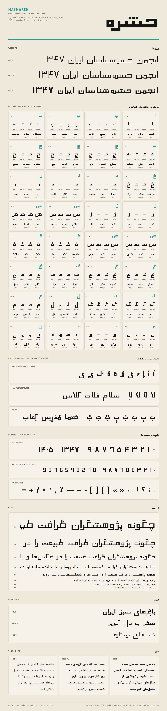
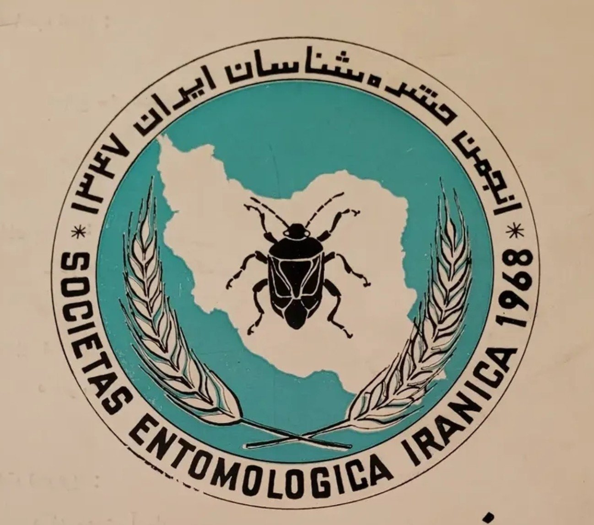
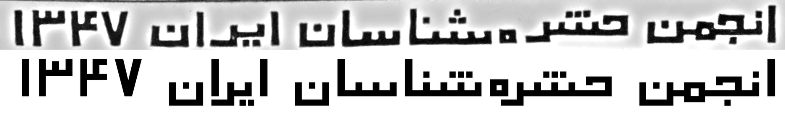

<div dir="rtl">

# حشره · Hashareh

حشره یک فونت فارسی تیتر به سبک مربعی است، در سه وزن. این فونت از روی نوشته‌ی فارسی آرم «انجمن حشره‌شناسان ایران» (سال ۱۳۴۷) ساخته شده است. خط‌ها همه یک ضخامت دارند، حروف روی یک کرسی صاف به هم وصل می‌شوند، و دندانه‌ها و نقطه‌ها مربعی‌اند.

این فونت رایگان و متن‌باز است و با [مجوز MIT](LICENSE) منتشر شده است.



[نمونه‌ی حروف](Hashareh-specimen.html) را در مرورگر هم می‌توانید باز کنید.

## آرم اصلی



در وسط آرم یک حشره روی نقشه‌ی ایران است و دو خوشه‌ی گندم دور آن. نوشته‌ی فارسی بالای آرم الهام‌بخش این فونت بوده است.

در تصویر زیر، بالا نوشته‌ی آرم است و پایین فونت حشره Bold، با ارتفاع الف یکسان.



## وزن‌ها

| وزن | نام در برنامه‌ها |
| --- | --- |
| Light (300) | Hashareh Light |
| Medium (500) | Hashareh |
| Bold (700) | Hashareh Bold، هم‌وزن آرم |

در Word و برنامه‌های مشابه، Hashareh را انتخاب کنید. با Ctrl+B بین Medium و Bold جابه‌جا می‌شوید. نام فارسی فونت در برنامه‌ها «حشره» است.

## نصب

در پوشه‌ی `fonts` سه نوع فایل هست:

| فایل | کاربرد |
| --- | --- |
| `.ttf` | نصب روی ویندوز، مک و لینوکس |
| `.otf` | برنامه‌های طراحی |
| `.woff2` | سایت |

- **ویندوز:** روی فایل‌های `.ttf` راست‌کلیک کنید و *Install* را بزنید.
- **مک:** روی فایل `.ttf` دو بار کلیک کنید و *Install Font* را بزنید.
- **لینوکس:** فایل‌های `.ttf` را در `~/.local/share/fonts` کپی کنید و `fc-cache -f` را اجرا کنید.

فقط یکی از دو نوع `.ttf` یا `.otf` را نصب کنید، نه هر دو را.

### استفاده در سایت

</div>

```css
@font-face { font-family: "Hashareh"; font-weight: 300; src: url(Hashareh-Light.woff2) format("woff2"); }
@font-face { font-family: "Hashareh"; font-weight: 500; src: url(Hashareh-Medium.woff2) format("woff2"); }
@font-face { font-family: "Hashareh"; font-weight: 700; src: url(Hashareh-Bold.woff2) format("woff2"); }
```

<div dir="rtl">

## حروف و امکانات

- همه‌ی حروف فارسی، به‌همراه حروف عربی رایج: ي ك ى ة ء أ إ آ ؤ ئ ۀ
- شکل جدا، اول، وسط و آخر هر حرف
- لام‌الف: لا لآ لأ لإ
- حرف بعد از ر ز ژ و ؤ کمی جلوتر می‌آید و روی پایه‌ی آن‌ها جا می‌گیرد.
- اِعراب: ـَ ـِ ـُ ـً ـٍ ـٌ ـّ ـْ ـٰ
- رقم‌های فارسی، عربی و لاتین، همه به سبک مربعی
- علامت‌های فارسی (، ؛ ؟ « » ٪ ٫ ٬) و علامت‌های ساده‌ی لاتین
- نیم‌فاصله و کشیده (ـ)

حروف لاتین در این فونت نیست.

## درباره‌ی طراحی

همه‌ی اندازه‌ها از خود آرم گرفته شده است. ارتفاع حروف در هر سه وزن یکی است، پس حروف در Light و Medium و Bold یک‌جور کنار هم می‌نشینند.

- بعد از ر ز ژ، پایه دقیقاً زیر لبه‌ی چپ الف بعدی تمام می‌شود. بعد از و، حرف بعدی دقیقاً از جایی شروع می‌شود که پایه تمام شده است.
- نقطه‌ها مربعی‌اند و در هر وزن یک اندازه دارند. سه نقطه‌ی ش، مثل آرم، در یک ردیف کنار هم هستند.

<details>
<summary>جدول ارتفاع‌ها (واحد از ۱۰۰۰)</summary>

| ارتفاع | چه چیزی در این ارتفاع است |
| --- | --- |
| 660 | ساقه‌ی الف، لام، کاف و ط، و رقم‌ها |
| 350 | سر ج ح خ، سر ف ق، حلقه‌ی ص ض ط ظ، جعبه‌ی م، دهانه‌ی ع غ، سر ی، ه اول کلمه |
| 300 | د ذ، ر ز ژ جدا، ه ة ۀ، سر و |
| 245 | دندانه‌ها، ر ز ژ آخر کلمه، پیاله‌ی ن، بالای م وسط کلمه، نوک کاسه‌ی س ص |
| 0 | کرسی |
| −165 | پایه‌ی ر ز ژ و، کف ن |
| −230 | کاسه‌ی س ص، نوک کاسه‌ی ج ح ع |
| −320 | کاسه‌ی ل ق ی |
| −400 | کاسه‌ی ج ح خ چ ع غ، دُم م |

</details>

## ساختن فونت از سورس

فونت‌ها با کد پایتون پوشه‌ی [`source`](source) ساخته می‌شوند:

</div>

```bash
pip install fonttools shapely brotli pillow
cd source
python build.py ../fonts
python specimen.py ../fonts ..
```

<div dir="rtl">

`build.py` هر سه وزن را با فرمت‌های TTF، OTF و WOFF2 می‌سازد. `specimen.py` نمونه‌ی حروف را به‌صورت HTML و PNG می‌سازد. برای ساختن PNG، مرورگر Chrome یا Edge لازم است.

## مجوز

© ۲۰۲۶ هاتف محمدعلی (کوزه‌چی). این فونت با [مجوز MIT](LICENSE) منتشر شده است. می‌توانید آزادانه از آن استفاده کنید، تغییرش بدهید، آن را منتشر کنید یا بفروشید؛ فقط متن حق نشر و مجوز را همراهش نگه دارید.

حشره یک فونت مستقل است و هیچ ارتباطی با انجمن حشره‌شناسان ایران ندارد و از طرف آن تأیید نشده است.

</div>
